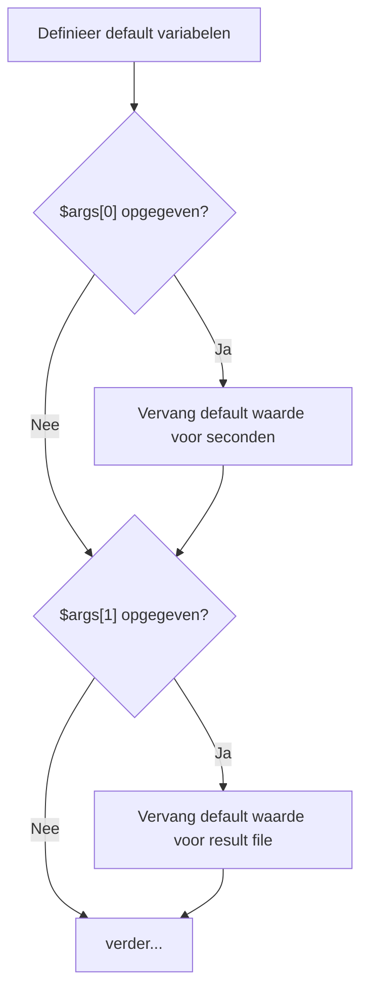
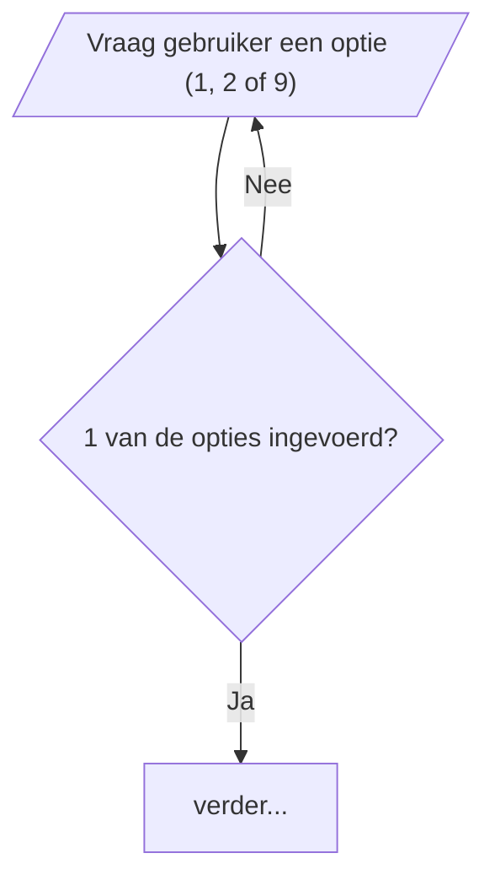
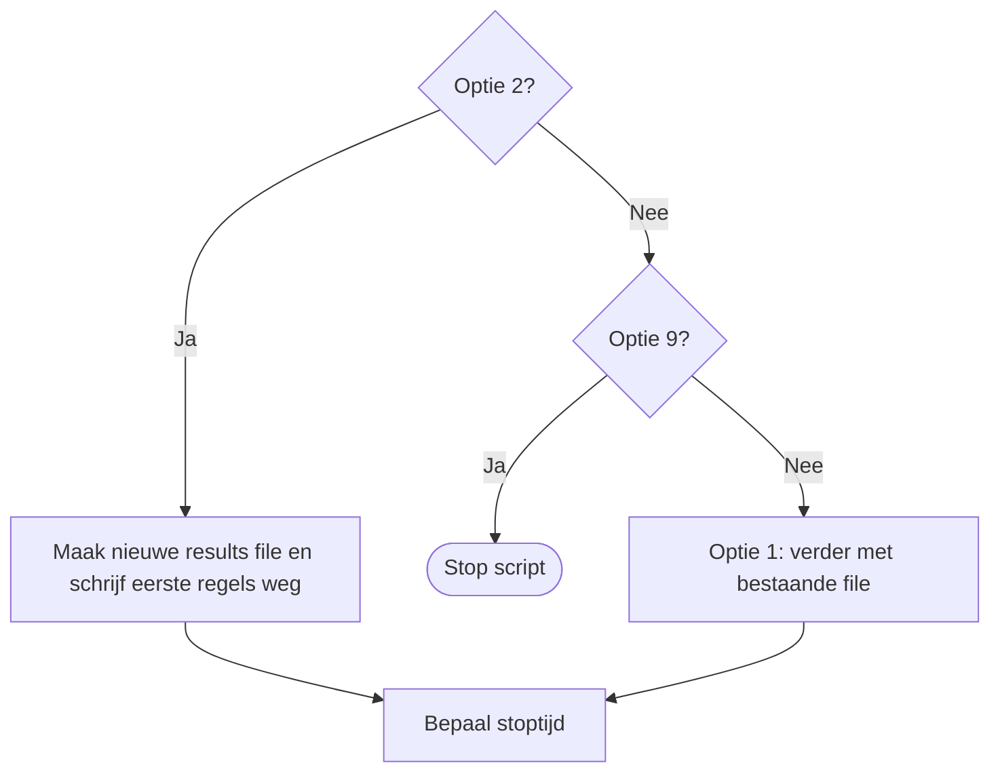
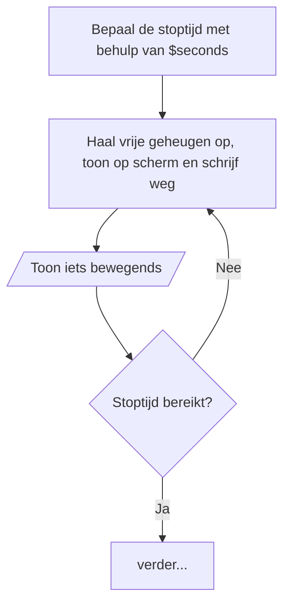
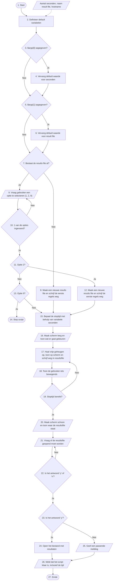
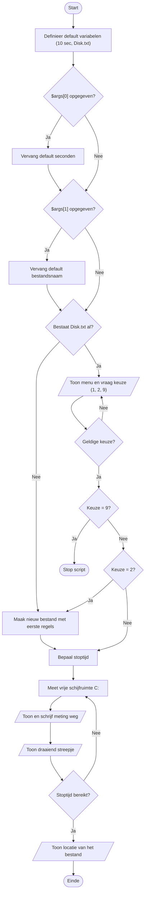
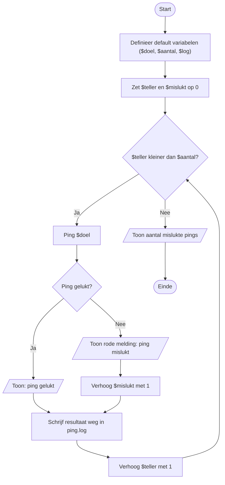
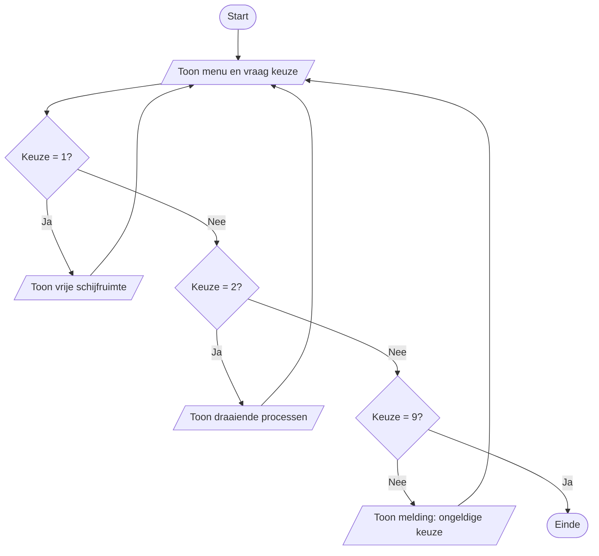
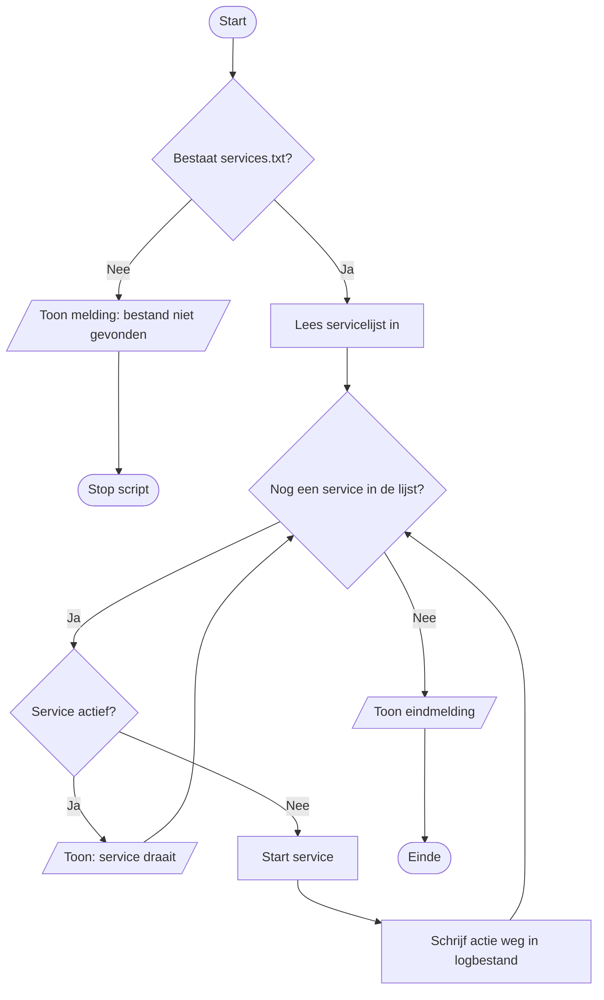
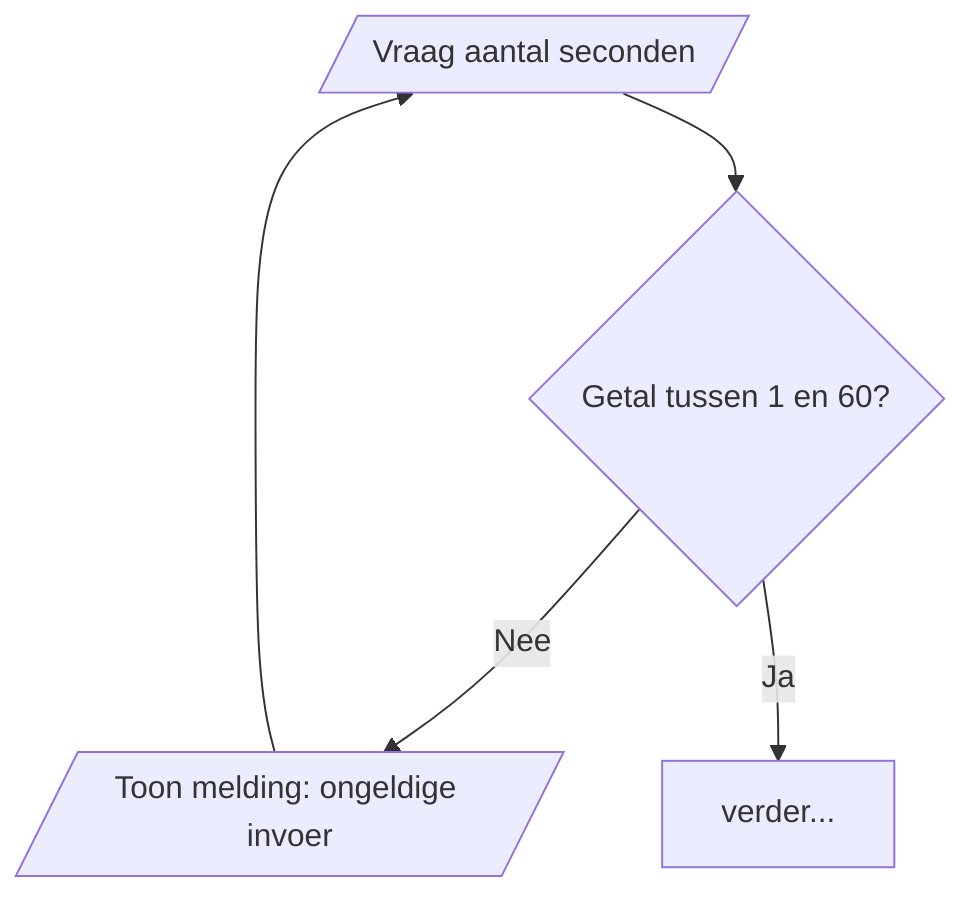

# ✏️ 1. Tekening: flowchart in Visio + ontwerpsjabloon

[← terug naar overzicht](README.md) · [2. PowerShell-script →](2-powershell-script.md) · [3. SQL →](3-sql.md)

**Waar let de beoordelaar op (9 punten, 3 per criterium)**
| Criterium | Wat de beoordelaar wil zien |
|---|---|
| T1 Beginsituatie | De eisen en wensen staan beschreven → het kopje **Doel** en **Aanpak** in het sjabloon. |
| T2 Ontwerp | De flowchart doet **alles** wat in de opdrachttekst staat, met de juiste symbolen. |
| T3 Communicatie | Je legt elke stap uit in **gewone taal** → **Toelichting bij stappen**, **Input/Output** met stapnummers, **Resultaat uitvoer**. |

> Het sjabloon telt dus net zo zwaar als de tekening. Laat het nooit leeg.

---

## 1. Stappenplan

1. **Lees** de hele opdrachttekst één keer zonder te tekenen.
2. **Nummer** elke zin/stap in de tekst (1, 2, 3...).
3. **Markeer signaalwoorden** (tabel hieronder): wat is een vraag, een lus, een bestand?
4. **Tel**: hoeveel invoerlussen, tijdlussen, keuzes zitten erin? (Bij MonitorFreeMemory: 2 invoerlussen, 1 tijdlus, 1 keuze met 3 uitkomsten.)
5. **Schets** kort op papier.
6. **Bouw** in Visio van boven naar beneden.
7. **Droog draaien**: volg met je muis 2 scenario's (bijv. "bestand bestaat niet" en "bestand bestaat, typ x, dan 2").
8. **Checklist** onderaan deze pagina langslopen.
9. **Sjabloon** invullen (screenshot flowchart erin plakken).

## 2. Visio: hoe teken je het

1. Visio (online) → **Nieuw** → sjabloon **Basisstroomdiagram** (Basic Flowchart). Links staan de vormen.
2. **Sleep** een vorm op het canvas en **typ** meteen de tekst.
3. **Snel verbinden**: ga met je muis over een vorm, klik op een **blauw pijltje** en kies de volgende vorm. De pijl wordt automatisch gemaakt.
4. **Pijl vastlijmen**: laat een pijl los **op** de vorm (de vorm licht groen/blauw op). Dan blijft hij vast als je schuift.
5. **Ja/Nee bij een pijl**: klik op de verbindingslijn en typ `Ja` of `Nee`.
6. **Terugpijl** (voor een lus): pak het **Verbindingslijn**-gereedschap (Connector) en trek van het Nee-punt van de ruit naar het blok waar je naartoe terug moet.
7. **Netjes**: selecteer meerdere vormen → **Uitlijnen** (Align) en **Positie** → **Gelijkmatig verdelen**.
8. **Stapnummers**: zet een klein tekstvak (of tekst in het blok) met het stapnummer bij elk blok.
9. **Exporteren**: Bestand → Exporteren → PNG, of maak een screenshot (`Win + Shift + S`) en plak die in het sjabloon.

## 3. Symbolen

| Symbool | Vorm in Visio | Gebruik bij | In PowerShell |
|---|---|---|---|
| **Start / Einde** | Begin/einde (ovaal) | Start van het script, Einde, *Stop script* | begin bestand, `Exit` |
| **Invoer / uitvoer** | Gegevens (parallellogram) | iets **vragen** of **tonen** aan de gebruiker, invoerdata | `Read-Host`, `Write-Host` |
| **Proces** | Proces (rechthoek) | variabele vullen, berekenen, iets doen | `$stopAt = ...` |
| **Document** | Document (golf onderaan) | bestand maken, schrijven, openen | `Set-Content`, `Add-Content`, `Invoke-Item` |
| **Beslissing** | Beslissing (ruit) | ja/nee-vraag, elke uitgang **gelabeld** | `If`, `While` |
| **Voorgedefinieerd proces** | Subproces | eigen functie | `function ...` |
| **Verbindingspunt** | Cirkel met letter (A, B) | sprong naar ander deel tekening | |
| **Pijl** | Verbindingslijn | richting, **altijd met pijlpunt** | |

## 4. Signaalwoorden: van tekst naar symbool

| Staat in de opdracht... | Symbool | Voorbeeld |
|---|---|---|
| vul, zet, bepaal, bereken, definieer | **Proces** | "Bepaal de stoptijd" |
| controleer of, als, zo ja / zo nee, opgegeven? | **Beslissing** | "Controleer of het bestand al bestaat" |
| zolang, herhaal, **net zolang tot** | **Beslissing + terugpijl** | "Vraag net zolang tot er y of n is ingevoerd" |
| vraag, toon, meld, geef een melding | **Invoer / uitvoer** | "Toon waar de resultsfile staat" |
| schrijf weg, maak een bestand, open | **Document** (of proces) | "Schrijf weg in de resultsfile" |
| start, stop het script, klaar | **Start / Einde** | "Stop script" |

## 5. De vier patronen die altijd terugkomen

### a. Argumenten (twee aparte ruiten!)


### b. Invoerlus ("vraag net zolang tot...")
De terugpijl gaat naar de **vraag**, niet naar het begin van het script.


### c. Keuze met drie uitkomsten (1 / 2 / 9)
Eerst controleren **of** het geldig is (invoerlus), daarna **welke** keuze (ruiten achter elkaar).


### d. Tijdlus
Stoptijd **vóór** de lus bepalen. Terugpijl naar het eerste blok in de lus.


---

## 6. Uitgewerkt voorbeeld: MonitorFreeMemory

Dit is de modelflowchart van de docent, met **stapnummers** erbij. Teken hem bij een nieuwe opdracht op dezelfde manier na voor het nieuwe script.



**Wat ik fout deed op de oefening (niet nog een keer doen!)**
- Invoerlussen waren één blok i.p.v. **vraag + ruit + terugpijl**. Twee invoerlussen = twee ruiten met terugpijl.
- Opties in de flowchart (a/o/s) kwamen niet overeen met het script (**1/2/9**).
- `$args[0]` en `$args[1]` in één ruit → moet in **twee ruiten**.
- Meerdere handelingen in één blok ("meet, toon, schrijf, toon voortgang") → **splitsen**. "Iets bewegends" is een eigen blok.
- Tikfouten ("bestaal"), labels niet consequent (`Ja`/`Nee` met hoofdletter), pijlen zonder pijlpunt.

---

## 7. Ontwerpsjabloon: ingevuld voorbeeld (MonitorFreeMemory)

Kopieer dit en pas het aan voor het nieuwe script. **Haal de voorbeeldtekst uit het sjabloon weg** (zoals "SOLAR PLEX NETWORK").

### Doel
> Het script MonitorFreeMemory meet een aantal seconden lang het vrije geheugen van de server waarop het draait. Elke meting wordt op het scherm getoond en weggeschreven naar een resultatenbestand in de vorm van een SQL-query. Zo kan de beheerder de metingen later in de MySQL-database `ritmania` (tabel `MemoryUsage`) laden en analyseren. De gebruiker kan zelf het aantal seconden en de naam van het resultatenbestand opgeven; doet hij dat niet, dan worden standaardwaarden gebruikt (5 seconden, Results.txt).

### Aanpak
> 1. Opdrachtbeschrijving gelezen en elke stap genummerd.
> 2. Flowchart ontworpen in Visio (Basisstroomdiagram) met de juiste symbolen voor proces, invoer/uitvoer, beslissing en start/einde.
> 3. Flowchart droog gedraaid met twee scenario's (bestand bestaat niet / bestand bestaat en gebruiker typt eerst een foute optie).
> 4. Op basis van de flowchart het script afgemaakt in PowerShell en alle paden getest.
> 5. De uitvoer in MySQL geladen en queries uitgevoerd.

### Stroomdiagram
> *(plak hier de afbeelding van je flowchart)*

### Toelichting bij stappen stroomdiagram
| Stap | Toelichting |
|---|---|
| 1 | Het script start. |
| 2 | De standaardwaarden worden ingesteld: 5 seconden, bestandsnaam Results.txt en de hostname van de machine. |
| 3–4 | Als de gebruiker een eerste argument (aantal seconden) heeft opgegeven, vervangt dit de standaardwaarde. |
| 5–6 | Als de gebruiker een tweede argument (bestandsnaam) heeft opgegeven, vervangt dit de standaardwaarde. |
| 7 | Het script controleert of het resultatenbestand al bestaat. |
| 8 | Bestaat het niet, dan wordt een nieuw bestand gemaakt met de eerste regels (DELETE- en INSERT-regel). |
| 9 | Bestaat het wel, dan krijgt de gebruiker een waarschuwing en moet hij kiezen: 1 aanvullen, 2 overschrijven, 9 stoppen. |
| 10 | Is de invoer niet 1, 2 of 9, dan wordt de vraag opnieuw gesteld (invoerlus). |
| 11–12 | Bij optie 2 wordt het bestand overschreven met de eerste regels. |
| 13–14 | Bij optie 9 stopt het script. Bij optie 1 gaat het script verder en worden de resultaten toegevoegd. |
| 15 | De stoptijd wordt berekend: huidige tijd + aantal seconden. |
| 16 | Het scherm wordt leeggemaakt en er verschijnt een regel met wat er gaat gebeuren, onderstreept met `=`-tekens. |
| 17 | Het vrije geheugen wordt opgehaald, op het scherm getoond en als SQL-regel weggeschreven. |
| 18 | De gebruiker ziet een aftelling, zodat duidelijk is dat het script nog bezig is. |
| 19 | Zolang de stoptijd niet bereikt is, wordt stap 17–18 herhaald (tijdlus). |
| 20 | Het scherm wordt leeggemaakt en het script toont waar het resultatenbestand staat. |
| 21–22 | De gebruiker wordt gevraagd of het bestand geopend moet worden; dit wordt herhaald tot hij y of n invoert (invoerlus). |
| 23–25 | Bij y wordt het bestand geopend, bij n krijgt de gebruiker een passende melding. |
| 26 | Het script meldt dat het klaar is, met de tijd erbij. |
| 27 | Einde van het script. |

### Input data
| Input | Stap |
|---|---|
| Aantal seconden (argument 1 of standaard 5) | stap 2 en 4 |
| Naam van het resultatenbestand (argument 2 of standaard Results.txt) | stap 2 en 6 |
| Hostname van de machine | stap 2 |
| Keuze van de gebruiker 1, 2 of 9 | stap 9 |
| Vrij geheugen van de machine (Win32_OperatingSystem) | stap 17 |
| Antwoord y of n | stap 21 |

### Output data
| Output | Stap |
|---|---|
| Resultatenbestand met DELETE- en INSERT-regel | stap 8 en 12 |
| Melding `WARNING: Results.txt already exists` + keuzemenu | stap 9 |
| Regel `Checking free virtual memory on SRV01 for 5 seconds` met `====` | stap 16 |
| `Free memory at <tijd>: <waarde>` op het scherm | stap 17 |
| SQL-regel `('SRV01',5006236,20261012153725),` in het bestand | stap 17 |
| Aftelling `> Next check in 3 / 2 / 1` | stap 18 |
| `Monitoring process is done. Results can be found in <pad>` | stap 20 |
| Geopend bestand of melding "Het bestand wordt niet geopend." | stap 24 / 25 |
| `Script finished at <datum en tijd>` | stap 26 |

### Resultaat uitvoer
```text
Checking free virtual memory on SRV01 for 5 seconds
===================================================
Free memory at 10/12/2026 15:37:25: 5006236
Free memory at 10/12/2026 15:37:28: 5007000
> Next check in 2
```
```text
Monitoring process is done. Results can be found in C:\Users\Administrator\Results.txt

Do you want to open it (y/n)?: n
Het bestand wordt niet geopend.
====================================
Script finished at 10/12/2026 15:38:30
```

---

## 8. Wat schrijf je IN een blok? (zin → blok)

De opdrachttekst is meestal lang. Jij maakt er **korte zinnen** van: een werkwoord + wat. Hieronder: wat er in de opdracht staat, welk symbool, en **letterlijk de tekst** die je in het blok typt.

### Proces (rechthoek)
| In de opdracht staat... | Tekst in het blok |
|---|---|
| "Stel standaardwaarden in voor het aantal seconden en de bestandsnaam" | `Definieer default variabelen` |
| "Als er een argument wordt meegegeven, gebruik dat dan als aantal seconden" | `Vervang default waarde voor seconden` |
| "Bereken wanneer het script moet stoppen" | `Bepaal de stoptijd met behulp van $seconds` |
| "Haal het vrije geheugen op" | `Haal vrije geheugen op` |
| "Lees de lijst met servers in" | `Lees serverlijst in uit bestand` |
| "Hoog de teller met 1 op" | `Verhoog teller met 1` |
| "Zet de teller op 0" | `Zet $teller op 0` |
| "Ping het doeladres" | `Ping $doel` |
| "Start de service opnieuw" | `Herstart service` |
| "Tel hoeveel processen er draaien" | `Tel aantal processen` |

### Invoer / uitvoer (parallellogram)
| In de opdracht staat... | Tekst in het blok |
|---|---|
| "Vraag de gebruiker of het bestand overschreven mag worden" | `Vraag: bestand overschrijven? (y/n)` |
| "Laat de gebruiker kiezen uit 1, 2 of 9" | `Toon menu en vraag keuze (1, 2, 9)` |
| "Toon een waarschuwing dat het bestand al bestaat" | `Toon waarschuwing: bestand bestaat al` |
| "Maak het scherm leeg en toon wat het script gaat doen" | `Maak scherm leeg en toon startmelding` |
| "Toon de gemeten waarde op het scherm" | `Toon gemeten waarde` |
| "Laat iets bewegends zien" | `Toon aftelling (iets bewegends)` |
| "Meld waar het bestand staat" | `Toon locatie van het resultatenbestand` |
| "Geef een passende melding" | `Toon melding: bestand wordt niet geopend` |
| "Meld dat het script klaar is met de tijd" | `Toon eindmelding met tijd` |
| "Vraag de naam van de server" | `Vraag servernaam` |

### Document (rechthoek met golf)
| In de opdracht staat... | Tekst in het blok |
|---|---|
| "Maak een nieuw resultatenbestand met de eerste regels" | `Maak nieuw resultatenbestand en schrijf eerste regels weg` |
| "Schrijf het resultaat weg" | `Schrijf meting weg in resultatenbestand` |
| "Voeg een regel toe aan het logbestand" | `Voeg regel toe aan logbestand` |
| "Open het bestand" | `Open resultatenbestand` |

> Mag je ook in een gewone rechthoek zetten (dat deed de docent ook). Zolang het consequent is.

### Beslissing (ruit): altijd een **vraag met ?**
| In de opdracht staat... | Tekst in de ruit | Labels |
|---|---|---|
| "Als er een eerste argument is opgegeven..." | `$args[0] opgegeven?` | Ja / Nee |
| "Controleer of het bestand al bestaat" | `Bestaat het resultatenbestand al?` | Ja / Nee |
| "Vraag net zolang tot 1, 2 of 9 is ingevoerd" | `Geldige keuze (1, 2, 9)?` | Nee → terug / Ja |
| "Bij keuze 9 stopt het script" | `Keuze = 9?` | Ja → Stop / Nee |
| "Zolang de tijd niet om is" | `Stoptijd bereikt?` | Nee → terug / Ja |
| "Herhaal 10 keer" | `$teller < 10?` | Ja → lus / Nee |
| "Als de ping lukt..." | `Ping gelukt?` | Ja / Nee |
| "Als de service niet draait..." | `Service actief?` | Ja / Nee |
| "Als het geheugen onder de 1 GB komt..." | `Vrij geheugen < 1 GB?` | Ja / Nee |
| "Vraag net zolang tot y of n" | `Antwoord y of n?` | Nee → terug / Ja |
| "Als de gebruiker y kiest..." | `Antwoord = y?` | Ja / Nee |

**Gouden tip:** zinnen met **"als"**, **"controleer"**, **"zolang"**, **"net zolang tot"**, **"herhaal"** worden **altijd** een ruit.

### Pijl-labels
- Bij een ja/nee-vraag: `Ja` en `Nee` (hoofdletter, consequent).
- Bij een keuze: de waarde zelf, bijv. `1`, `2`, `9`.
- Een terugpijl hoeft geen extra tekst, het label `Nee` (of `Ja`) staat al op de uitgang van de ruit.

---

## 9. Oefensituaties met uitwerking

Probeer eerst zelf te tekenen, kijk daarna naar de uitwerking.

### Situatie A: DiskSpace-monitor (lijkt het meest op de oefening)
> *Het script heeft als standaard 10 seconden en bestand Disk.txt. Als de gebruiker argumenten meegeeft, worden die gebruikt. Als het bestand al bestaat, kiest de gebruiker: 1 aanvullen, 2 overschrijven, 9 stoppen; er wordt net zolang gevraagd tot de keuze geldig is. Zolang de tijd niet om is: meet de vrije schijfruimte van C:, toon en schrijf weg, toon een draaiend streepje. Toon aan het eind waar het bestand staat.*

Tellen: 2 argument-ruiten, 1 invoerlus, 1 keuze met 3 uitkomsten, 1 tijdlus.



### Situatie B: PingLogger (tellerlus)
> *Het script pingt een doeladres (standaard 8.8.8.8) een aantal keer (standaard 5). Het resultaat van elke ping wordt getoond en in ping.log gezet. Lukt de ping niet, dan krijgt de gebruiker een rode melding. Aan het eind wordt het aantal mislukte pings getoond.*


Let op: de terugpijl gaat naar de **ruit** (`$teller kleiner dan $aantal?`), en de teller wordt **in** de lus verhoogd.

### Situatie C: Menu dat blijft terugkomen
> *Het script toont een menu: 1 = toon vrije schijfruimte, 2 = toon draaiende processen, 9 = afsluiten. Na elke keuze komt het menu terug, tot de gebruiker 9 kiest. Bij een ongeldige keuze krijgt de gebruiker een melding.*



### Situatie D: Service-check met lijst (ForEach)
> *Het script leest een lijst met servicenamen uit services.txt. Bestaat dat bestand niet, dan stopt het script met een melding. Voor elke service wordt gecontroleerd of hij draait. Zo niet, dan wordt hij gestart en wordt dat in een logbestand gezet.*


Een **ForEach** teken je als ruit `Nog een ... in de lijst?` met een terugpijl.

### Situatie E: Invoer controleren op een getal
> *Vraag de gebruiker hoeveel seconden er gemeten moet worden. Dit moet een getal tussen 1 en 60 zijn; vraag net zolang tot dat zo is.*



---

## 10. Vastgelopen? Stel jezelf deze vragen
1. **Wat is de allereerste stap?** Bijna altijd: *Definieer default variabelen*.
2. **Staat er "als" of "controleer"?** → ruit. Wat zijn de twee uitgangen?
3. **Staat er "net zolang tot" of "zolang"?** → ruit + terugpijl. Waar moet de pijl heen? (naar de **vraag** bij invoer, naar het **eerste blok in de lus** bij een tijd-/tellerlus)
4. **Moet de gebruiker iets zien of typen?** → parallellogram.
5. **Stopt het script hier?** → Einde-symbool (*Stop script*).
6. **Komen twee paden weer samen?** → laat beide pijlen naar hetzelfde volgende blok wijzen.
7. **Weet je niet hoe je het moet noemen?** Gebruik de woorden uit de opdracht zelf, ingekort.
8. **Te groot voor de pagina?** Gebruik verbindingspunten **A**, **B** (rondje met letter).

> Liever een simpele, **volledige** tekening dan een mooie halve. Twijfel je over een symbool? Kies er één en wees consequent.

---

## 11. Checklist vóór inleveren
- [ ] Precies **één Start**; elk pad eindigt bij een Einde (of *Stop script*)
- [ ] Elke stap uit de beschrijving zit erin (vergelijk je nummers)
- [ ] Juiste symbool per stap (vraag/toon = parallellogram!)
- [ ] Elke ruit is een **vraag met ?** en uitgangen **Ja / Nee** (of 1/2/9)
- [ ] Elke "net zolang tot" heeft een **terugpijl naar de vraag**
- [ ] Tijdlus: terugpijl naar het **eerste blok in de lus**
- [ ] Elke lus kan echt eindigen
- [ ] Alle pijlen hebben een pijlpunt en zitten vast
- [ ] Geen kruisende lijnen, netjes uitgelijnd
- [ ] Geen code in de blokken (wel variabelenamen zoals `$seconds`)
- [ ] Opties en teksten kloppen met het script
- [ ] Blokken genummerd, sjabloon **helemaal** ingevuld

> **Gouden regel:** teken wat de beschrijving vraagt. Niet meer, niet minder.
